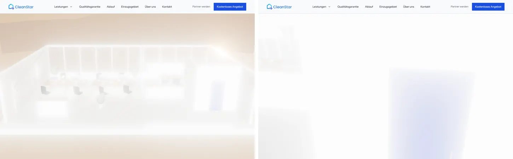
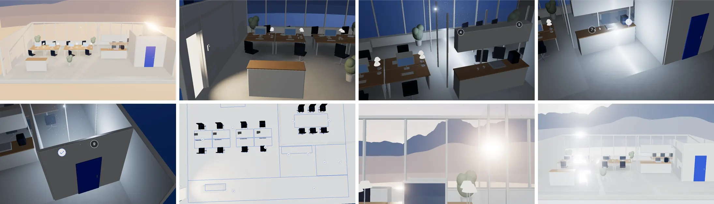
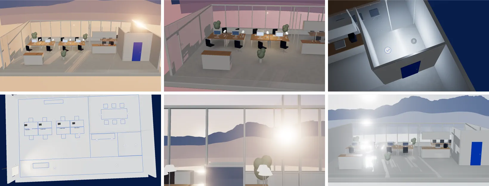
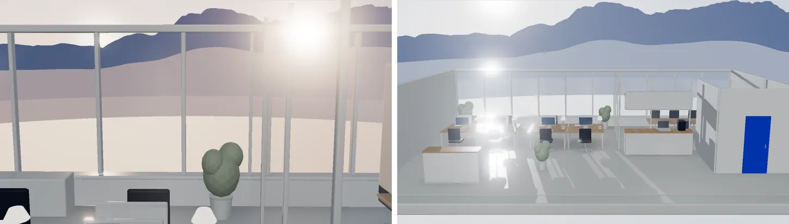
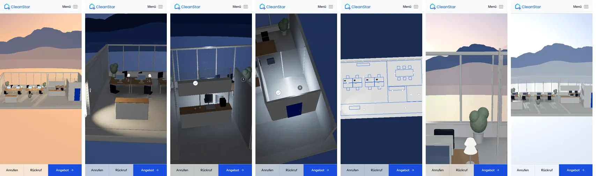

# Signatur-Szene „Eine Nacht in Ihrem Büro“: Review

Prototyp auf `/labor/nacht` (noindex, nicht verlinkt). Startseiten-Einbau vorbereitet über `features.signatureScene` in `src/content/features.ts` (steht auf `false`).

Maßstab je Runde: Wirkt es wie ein teures Architekturmodell oder wie ein Spiel? Ist das Licht schön? Ist jede Bewegung weich und motiviert? Versteht man ohne Text, was passiert?

Aufnahmen: Desktop 1440 × 900, Handy 390 × 844, jeweils feste Momente des Nacht-Lineals (Software-Rendering, daher ohne Kantenglättung des Browsers; auf echter Grafik schärfer).

## Erster Stand

Unbrauchbar: alles milchig weiß. Ursachen gefunden mit einem Fehlersuch-Schalter (`?dbg=`): Das Studio-Umgebungslicht (RoomEnvironment) beleuchtete die Szene auch nachts voll, und der Bloom glühte auf allen weißen Flächen. Die Lichtkante stand direkt vor der Kamera und überstrahlte das Bild.

## Runde 1

Behoben: Umgebungslicht folgt jetzt der Uhrzeit (nachts 5 %), Bloom nur noch über der Helligkeit echter Lichtquellen (Bildschirme, Lampen, Funken), Lichtkante dezenter.

Befund: Das Modell liest sich als Architekturmodell, die Ankunft um 19:15 (Lichtstreifen aus dem Flur) ist der stärkste Moment. Aber: Kamera in der Küchen-Zone hinter dem Sanitär-Kubus (Bild 3 vorher), Möbel schweben ohne Kontaktschatten, Abend zu blass und orange verschleiert.

## Runde 2

Behoben:
- Umgebungsverdeckung wird beim Laden einmal gebacken (Draufsicht, zweifach weichgezeichnet, als Boden-Textur). Kostet zur Laufzeit nur einen Texturzugriff.
- Kamera folgt der Kante jetzt erhöht von vorn links, nie hinter dem Kubus, beim Sanitär von oben.
- Abendlicht: mehr direkte Sonne, weniger Füll-Licht, dadurch lange Schatten und Kontrast.
- Schwarzwald weniger überhöht (2,1-fach statt 3,2-fach).
- Grundriss-Ansicht zeigt das ganze Büro; auch die Stühle werden zu Linien und Weiß.

Befund: 18:00 warm mit langen Schatten, 21:45 sauber lesbar als Grundriss mit abgehakten Punkten. Offen: 7:00 innen zu dicht (Lampe und Pflanze vor dem Sonnenaufgang), Schlussbild überstrahlt.

## Runde 3

Behoben: Kamera um 7:00 höher und weiter zurück (freier Blick auf den Sonnenaufgang hinter dem echten Höhenprofil), Lichtstrahlen und Bloom am Morgen zurückgenommen. Das Schlussbild zeigt das saubere Büro im Morgenlicht, Lichtbahnen über den Boden, dahinter der Schwarzwald.

Handy: alle Phasen geprüft, Kamera weiter zurück und höher, damit das Büro ins Hochformat passt. Die Szene läuft dort mit 5.000 Partikeln, ohne Bloom und mit begrenzter Pixeldichte (1,5).

Weiter offen für die Freigabe: Ton (optional, nicht umgesetzt), die Szene im Hero der Startseite ist vorbereitet, aber ausgeschaltet.

## Entscheidungen

| Thema | Entscheidung |
| --- | --- |
| Referenz-Runde (Nacht-Lineal A1, Höhenprofil D2) | Der Prompt dazu lag nicht vor. Das Nacht-Lineal ist hier neu gebaut (`src/features/night/timeline.ts`: eine Zeitquelle für Licht, Kamera, Texte), das Höhenprofil aus dem selbst gehosteten Höhenmodell berechnet (`scripts/night/skyline.py`, Blick vom Sitz in Offenburg nach Osten, Azimut 55° bis 125°, mit Erdkrümmung). |
| Fensterfront | Nach Osten (Schwarzwald). Abendlicht fällt stilisiert warm durch dieselben Fenster, der Sonnenaufgang steht real hinter dem Höhenprofil. |
| Schlussfahrt | Die Kamera blickt erst auf den Sonnenaufgang und zieht dann rückwärts durch das offene Modell nach draußen; das Schlussbild zeigt die Fensterfront mit dem Morgen dahinter. Wörtlich „rückwärts durch die Fensterfront“ hätte den Sonnenaufgang hinter die Kamera gelegt. |
| Zonen und Texte | Fünf Zonen in der Reihenfolge aus `floorplan.ts` (Arbeitsplätze, Besprechung, Küche, Sanitär, Flur). Zeilen nur aus den Aufgaben dort; „Bildschirme“ aus dem Beispiel des Prompts nicht übernommen, weil das Leistungsverzeichnis Bildschirme ausdrücklich ausnimmt. |
| Alarmanlage | Kurz rot blinkend beim Eintreten, grün nach der Kontrolle. „Alarmanlage nach Protokoll“ ist durch die Zuständigkeiten auf Über uns gedeckt (Schlüssel und Zugang). |
| GPU-Erkennung | Kein detect-gpu: Das Paket lädt seine Messdaten von einem fremden Server (DSGVO-Regel). Stattdessen: WebGL2-Prüfung, Software-Renderer erkennen, erste 70 Bilder messen; zu langsam → Standbilder. |
| Vorberechnetes Licht | Umgebungsverdeckung beim Laden gebacken statt N8AO in Echtzeit. Echtzeit nur für die Sonnen-Schatten (eine Schattenkarte) und den Bloom am Desktop. |
| Ton | Optional, nicht umgesetzt. |
| Modelle | Alles prozedural, kein heruntergeladenes Modell, keine Lizenzfragen. |
